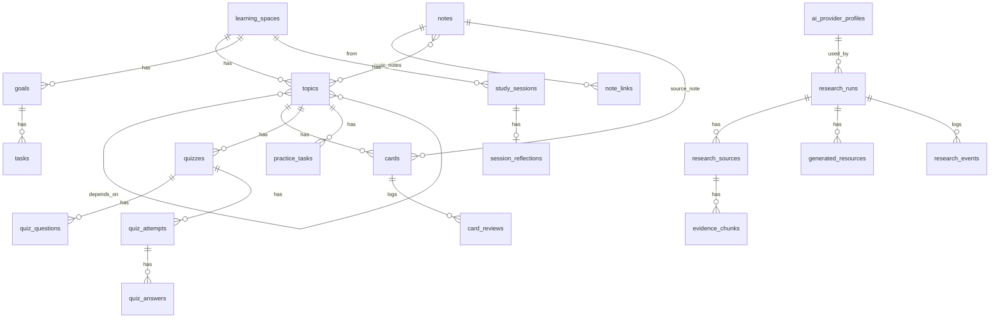

# ARCHITECTURE — stack, ADR-lər, AI/MCP, data modeli (D7, D8, D10)

Hamısı `PROPOSED`-dir, yalnız "lokal web + Docker" (DEC-11) və "personal instance" (DEC-02) `CONFIRMED`-dir.

## 1. Ümumi forma
**Tək Node prosesi, tək konteyner, tək SQLite faylı.** Konteynerdə: HTTP server (API + statik SPA) + in-process job worker + file watcher. Əlavə servislər optional sidecar-lardır: Ollama, SearXNG.

```
Browser (React SPA) ──HTTP/SSE──> Node server (Fastify)
                                   ├── modules/* (domain, Zod contracts)
                                   ├── storage: SQLite (better-sqlite3 + Drizzle) | vault FS
                                   ├── worker: jobs table, lease, checkpoints
                                   ├── ai/: ProviderRegistry → adapters (ollama, openai-compat, anthropic…)
                                   └── tools/: ToolRegistry (fetch, notes.search…) → [later] MCP client
                    optional ──> Ollama :11434   optional ──> SearXNG :8080
```

## 2. ADR-lər (repo yaradılanda `docs/ADR/` fayllarına bölünəcək)

### ADR-001 — Frontend/backend stack
- **Kontekst:** tək istifadəçi, lokal, uzun sürən job-lar, SSE, fayl izləmə, Docker.
- **Variantlar:** (a) Next.js full-stack; (b) **Vite + React SPA + Fastify**; (c) SvelteKit (adapter-node); (d) Hono + React.
- **Qərar (PROPOSED): (b).** Səbəblər: worker və watcher adi Node prosesidir, framework runtime-ı ilə mübarizə aparmaq lazım gəlmir; SSR-ə ehtiyac yoxdur (localhost, SEO yoxdur); build və upgrade səthi kiçikdir; contributor üçün API sərhədi aydındır (`/api/*` + Zod). Fastify plugin ekosistemi (helmet, rate-limit, multipart) yetkindir.
- **Qiymət:** routing, data fetching (TanStack Query/Router) əl ilə seçilir. Next.js-in hazır konvensiyaları itir.
- **Next.js nə vaxt düzgün olardı:** çox istifadəçili hosted versiya və ya SEO tələbi yaranarsa. İkisi də non-goal-dır.
- **UI:** Tailwind + shadcn/ui (Radix əsaslıdır, a11y yaxşıdır, kod repoya kopyalanır, ona görə vendor lock yoxdur). CodeMirror 6 (D14 #1).

### ADR-002 — Data ownership: fayl vs SQLite
OBSIDIAN_STRATEGY §2. Qeyd məzmunu fayldadır. Qalan hər şey SQLite-dadır. İkitərəfli sync yoxdur.

### ADR-003 — SQLite əməliyyat modeli
`better-sqlite3` (sinxron, sürətli, yetkin) + Drizzle migrations. WAL rejimi, `foreign_keys=ON`, `busy_timeout`. Backup üçün SQLite online backup API (`db.backup()`) istifadə olunur, fayl kopyalanmır. `node:sqlite` stabilləşəndə yenidən baxılacaq (`UNVERIFIED` cari status). Bütün yazmalar bir prosesdən keçir, ona görə concurrency problemi yoxdur.

### ADR-004 — Background jobs
`jobs(id, kind, status, payload, step, checkpoint_json, lease_until, attempts, error_code)`. Worker hər N ms-də `UPDATE … SET lease_until=now+30s WHERE status='queued' … RETURNING` ilə job götürür və heartbeat ilə lease-i uzadır. Hər addım bitəndə `checkpoint` yazılır (idempotent addımlar). **Startup:** `status='running' AND lease_until<now` → `interrupted`. İstifadəçi UI-da "Resume" seçir, job son checkpoint-dən davam edir. Avtomatik retry yalnız transient xətalar üçündür (max 3, eksponensial backoff). Cancellation: `AbortController` + DB flag. Hər addım arasında flag yoxlanılır.

### ADR-005 — Deployment və təhlükəsizlik profilləri
- `docker-compose.yml`: `ports: "127.0.0.1:3000:3000"`, non-root user (`user: "${UID}:${GID}"`), `read_only: true` rootfs + yazıla bilən volume-lar, `cap_drop: [ALL]`, `no-new-privileges`. Healthcheck `/api/health`.
- Vault mount-ları: `${HUB_VAULT}:/data/vault`, `${LINKED_VAULT}:/linked:ro`. SELinux üçün `:Z` sənədləşdirilir.
- **HUB_MODE=local** (default): ilk açılışda random token yaradılır, log/CLI `http://127.0.0.1:3000/?token=…` çap edir → HttpOnly SameSite=Strict cookie qoyulur. Hər sorğuda `Host` ∈ {127.0.0.1, localhost} və Origin yoxlanır (DNS rebinding və CSRF müdafiəsi). Bunsuz localhost "auth-suz" qəbul edilmir.
- **HUB_MODE=remote:** parol (argon2id), secure cookie, CSRF token, rate limit, `TRUST_PROXY`. HTTPS reverse proxy sənədləşdirilir. Server `0.0.0.0`-a yalnız bu rejimdə bind olur, əks halda başlamır.
- Windows: vault WSL2 fayl sistemində olmalıdır (performans və inotify üçün). macOS: polling watcher.

### ADR-006 — Spaced repetition
`ts-fsrs` (MIT). Kart state-i (`due, stability, difficulty, reps, lapses, state, last_review`) və hər review (`rating, elapsed, scheduled`) saxlanılır. Review log tam saxlanılır, gələcəkdə optimizer işlədə bilmək üçün. Desired retention ayarı 0.80–0.95 aralığındadır, default 0.9.

### ADR-007 — AI provider abstraksiyası
§3. AI kodu `ai/` modulundadır. Domain modulları yalnız `AIService` interfeysini import edir. AI paketi silinsə belə core build olur (ESLint import boundary qaydası).

### ADR-008 — Secrets
BYOK açarları `data/secrets.json`-da saxlanılır (0600). Şifrələmə açarı: OS keychain olmadığı üçün (Docker) `HUB_SECRET_KEY` env/Docker secret-dən götürülür, AES-256-GCM ilə. Env verilməyibsə açarlar plaintext saxlanılır, amma UI xəbərdarlıq edir. Açar heç vaxt brauzerə qaytarılmır (yalnız `sk-…abcd` maskası), log redaction tətbiq olunur. Bu "best-effort" müdafiədir: host-da root olan şəxsə qarşı qoruma vermir, bu da sənədləşdirilir.

### ADR-009 — i18n
UI üçün `i18next` (ICU plugin) və ya `@formatjs` (hər ikisi uyğundur, birini seç). Açarlar namespace-lərə bölünür. CI açar paritetini yoxlayır (en ↔ az).

## 3. AI dizaynı (D8)

### 3.1 Rejimlər
`disabled` (default) · `local` (Ollama native API) · `openai_compatible` (Ollama `/v1`, LM Studio, vLLM, OpenRouter…) · `byok` (Anthropic/OpenAI/Gemini native adapter-ləri; v1-də **bir** cloud adapter + openai-compatible).

**Build vs library:** Vercel AI SDK provider abstraksiyası, Zod ilə structured output, streaming və tool calling verir. Onu **adapter-lərin altında** istifadə etmək öz HTTP klientlərimizi yazmaqdan ucuzdur. Riski API dəyişiklikləridir. Ona görə domen yalnız bizim nazik interfeysimizi görür. Ollama provider-inin cari statusu `UNVERIFIED`-dir, alternativ olaraq openai-compatible yolu işlənir.

### 3.2 Kontrakt
```ts
type Capability = 'text' | 'structured' | 'tools' | 'embeddings' | 'streaming' | 'vision';
interface ModelProfile {
  id: string; providerId: string; model: string;
  declared: Capability[];          // istifadəçi/adapter bildirir
  probed?: { capability: Capability; ok: boolean; at: string }[]; // smoke test nəticəsi
  contextTokens?: number; locality: 'local' | 'remote';
}
interface AIProvider {
  id: string;
  health(signal: AbortSignal): Promise<{ ok: true; latencyMs: number } | { ok: false; error: AIError }>;
  listModels?(): Promise<string[]>;
  generateText(req: TextRequest, signal: AbortSignal): AsyncIterable<TextEvent>; // streaming-first
  generateObject<T>(req: ObjectRequest<T>, signal: AbortSignal): Promise<ObjectResult<T>>;
  callWithTools?(req: ToolRequest, signal: AbortSignal): Promise<ToolTurn>;
}
type ObjectResult<T> =
  | { ok: true; value: T; attempts: number; usage?: Usage }
  | { ok: false; error: AIError; rawSnippet?: string; attempts: number };
type AIErrorCode = 'unreachable' | 'auth' | 'rate_limited' | 'context_overflow' | 'schema_invalid'
  | 'refused' | 'timeout' | 'cancelled' | 'budget_exceeded' | 'capability_missing' | 'unknown';
```
- **Structured fallback zənciri:** native schema (`format`/`response_format`) → JSON mode + schema mətni promptda → "repair" turu (Zod xətaları geri göndərilir) → **max 2 retry** → `schema_invalid`. Uğursuz nəticə draft kimi saxlanılmır (RS-AC-05).
- **Tool calling yoxdursa:** Research Studio onsuz da **deterministik orkestrator** ilə işləyir. Search/fetch-i server edir, model yalnız sintez edir. Tool calling yalnız Socratic tutor-da "qeydlərimdə axtar" kimi optional imkandır.
- **Capability probing:** "Test model" düyməsi 3 kiçik test aparır (text, 1 sadə schema, 1 tool call) və nəticəni `probed` sahəsində saxlayır. UI degradasiyanı buna əsasən göstərir.
- **Budget:** hər çağırışda `maxOutputTokens`, run səviyyəsində token büdcəsi və (remote üçün) istifadəçinin verdiyi təxmini qiymət cədvəli. Qiymət hardcode olunmur.
- **Mock provider:** deterministik fixture cavabları ilə. Bütün testlər onunla işləyir.

### 3.3 Pedaqoji qat
Prompt şablonları `ai/prompts/*.md`-də, versiyalı (`prompt_version` hər generasiyada saxlanılır). Socratic davranış SPEC §9-da təsvir olunur.

### 3.4 MCP yolu
- **Phase A (Phase 3–4):** daxili `ToolRegistry`: `{name, inputSchema(Zod), permission: 'read'|'draft', handler}`. Write tool yoxdur, yalnız draft yaradılır.
- **Phase B (post-1.0):** MCP Client. 2026-07-28 spec-ə görə core stateless-dir: `initialize` və `Mcp-Session-Id` yoxdur, versiya və capabilities hər sorğunun `_meta`-sındadır, server-initiated sampling/elicitation əvəzinə MRTR (`input_required`) var, köhnə HTTP+SSE transportu deprecated-dir. Tətbiqdən əvvəl rəsmi TypeScript SDK-nın bu versiyanı dəstəklədiyi yoxlanmalıdır (blog-a görə dəstəkləyir). Qaydalar: server allowlist, hər server üçün tool allowlist, write-like tool-larda hər çağırışda təsdiq, tool description-ları prompt-a "untrusted" etiketi ilə daxil edilir, nəticələr audit loguna yazılır. Remote HTTP server-lərdə OAuth (RFC 9207 `iss` validasiyası; DCR deprecated → CIMD) tələb olunur, bu ciddi işdir. Ona görə v1-də yalnız **stdio** lokal server-lər.
- **Phase C (Phase 6+):** Hub MCP Server, read-only: `topics.list`, `notes.search`, `review.due`, `weak_topics`. Stdio transport, Hub DB-yə read-only connection. Peer-lər Claude Code və ya Codex-də "bu həftə nəyi unutmuşam?" soruşa bilər. Dəyəri yüksəkdir, riski aşağıdır, amma core-dan sonra gəlir.

## 4. Data modeli (D10)



Əsas cədvəllər (seçilmiş sahələr):
- `notes(id ULID, vault 'hub'|'linked', path, title, content_hash, mtime, size, frontmatter_json, index_state, missing_since)` — məzmun yoxdur, FTS5 virtual cədvəli `notes_fts(title, body)` ayrıcadır.
- `note_links(from_note, target_raw, target_note NULL, kind 'wiki'|'md'|'embed', anchor)` — unresolved linklər də saxlanılır.
- `topic_notes(topic_id, note_id, source 'manual'|'frontmatter'|'research')`.
- `cards(id, topic_id, note_id NULL, block_anchor NULL, front, back, origin 'manual'|'ai'|'import', origin_resource_id NULL, fsrs_* sahələri, suspended)`.
- `quiz_questions(id, quiz_id, type 'mcq'|'multi'|'short_self', prompt, options_json, answer_json, explanation, topic_id)`; `quiz_attempts(id, quiz_id, mode 'practice'|'exam', confidence_pre 1..5 NULL, started_at, finished_at, score)`.
- `research_*` → SPEC §5.

**Silmə semantikası:**
- Topic silinəndə kartlar və quiz-lər "Unassigned"-a keçir (soft), attempt və review log-ları heç vaxt cascade ilə silinmir.
- Space silinməsi soft-delete-dir (30 gün), sonra hard delete edilir və silinmədən əvvəl avtomatik backup alınır.
- Fayl itəndə `notes.missing_since` qoyulur, bağlantılar saxlanılır (rename detection üçün).

**Backup vahidi:** `hub-backup-<ts>.zip` = `hub.db` (online backup API ilə) + Hub vault + `manifest.json` (schema versiyası, app versiyası, sayğaclar, sha256). Linked vault backup-a **daxil deyil**, çünki o, istifadəçinin öz backup-ına aiddir. Bu açıq göstərilir.
**Restore:** yalnız boş instansiyaya və ya "replace" təsdiqi ilə. Əvvəlcə manifest preview göstərilir, köhnə schema versiyası olarsa migration işə düşür.
**Migrations:** irəli istiqamətdə, idempotent. Hər upgrade-dən əvvəl avtomatik backup alınır.

## 5. Modul sərhədləri
```
src/server/modules/{spaces,topics,notes,vault,cards,quizzes,sessions,goals,dashboard,ai,research,settings,backup}
src/server/lib/{db,fs-safe,http-safe,security,i18n,jobs}
src/shared/contracts/*.ts      # Zod schemas — server və web eyni faylları import edir
src/web/{routes,components,features/*}
```
Qayda: modullar bir-birinin DB cədvəllərinə birbaşa yazmır, yalnız servis funksiyaları vasitəsilə. `ai` və `research` modulları core-dan asılıdır, əksinə asılılıq yoxdur.
